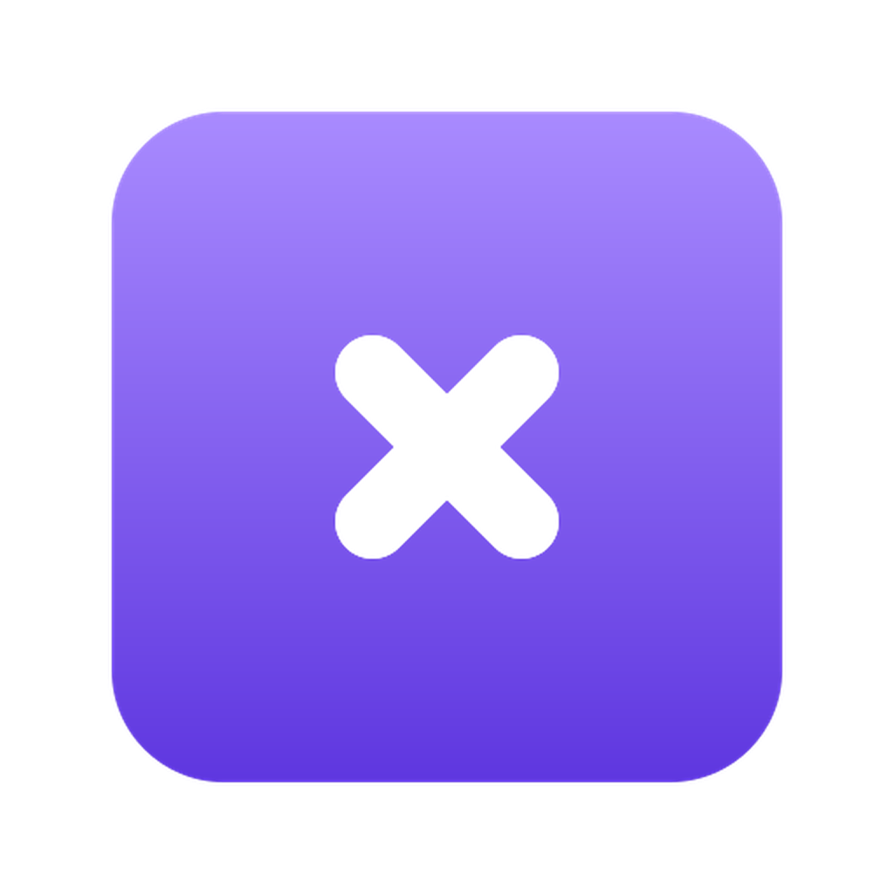
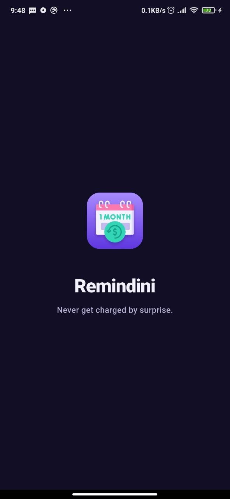
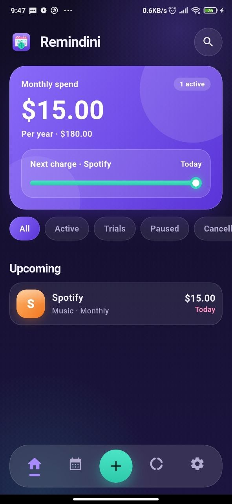
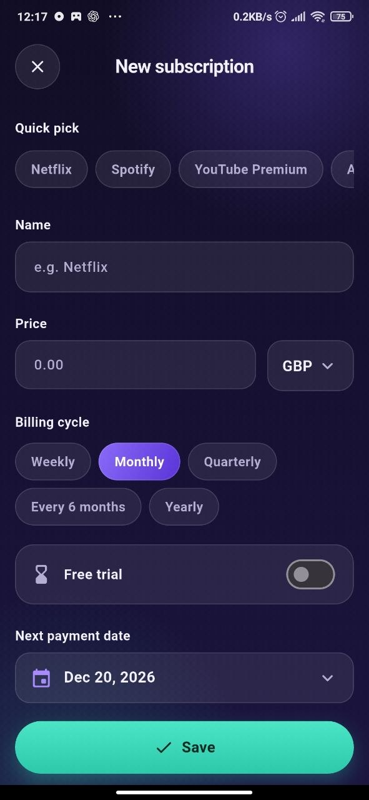
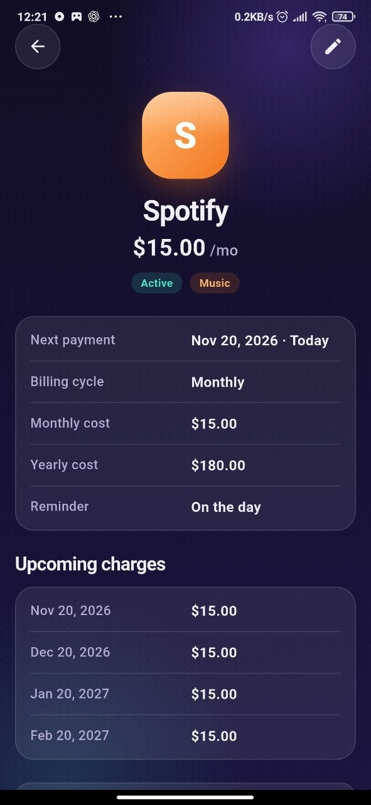
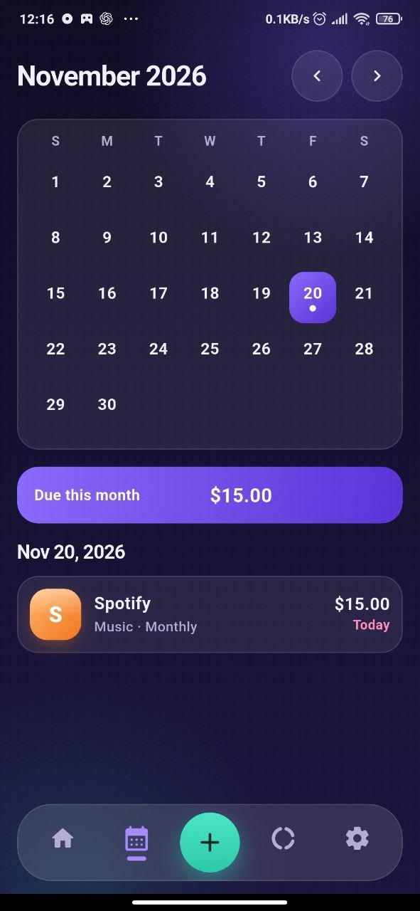
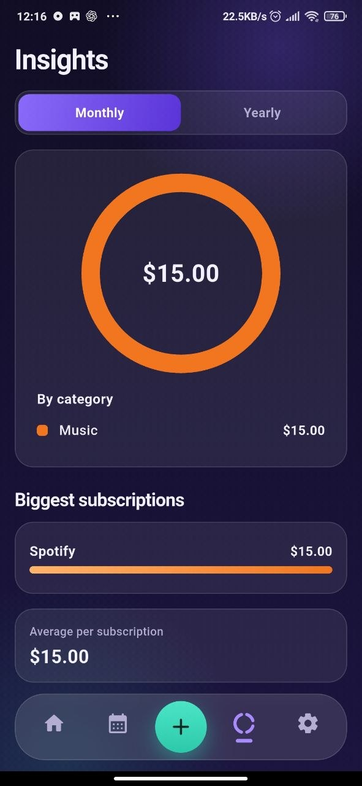
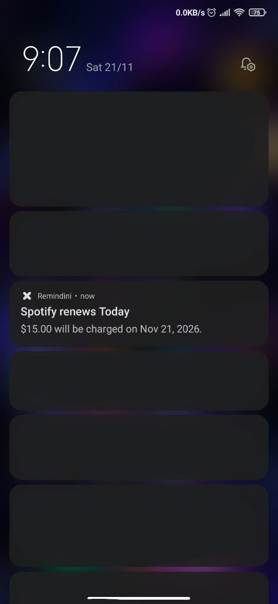

<p align="center">
  
</p>

<h1 align="center">Remindini</h1>
<p align="center"><b>Never get charged by surprise.</b><br>Track every subscription, see what leaves your account and when, and cancel free trials in time.</p>

<p align="center">
  
  
  
  
  
</p>

## Screenshots

<div align="center">
<table align="center">
  <tr>
    <td align="center"><br><sub>Launch screen</sub></td>
    <td align="center"><br><sub>Home</sub></td>
    <td align="center"><br><sub>Add a subscription</sub></td>
    <td align="center"><br><sub>Details</sub></td>
  </tr>
  <tr>
    <td align="center"><br><sub>Calendar</sub></td>
    <td align="center"><br><sub>Insights</sub></td>
    <td align="center"><br><sub>Reminder notification</sub></td>
    <td></td>
  </tr>
</table>
</div>

## Features

- Every subscription in one place: price, billing cycle, next charge, category, notes
- Free-trial tracker with a reminder before the first charge
- Reminders 0 to 7 days before each payment, at the time you choose
- Home with monthly and yearly spend, a "next charge" bar, and trials ending soon
- Calendar of upcoming charges, Insights by category, biggest subscriptions, money saved by cancelling
- Pause, resume, mark as cancelled, swipe to delete with undo
- English, French and Arabic with full right-to-left layout; designed light and dark themes
- Private by design: no account, no server, no analytics, no internet permission

## Quick start

You need [Flutter](https://docs.flutter.dev/get-started/install) (3.38.1 or newer) and an Android phone or emulator.

1. Get the code

```
git clone https://github.com/goucem-meriem-malak/remindini.git
cd remindini
flutter pub get
```

2. Run

```
flutter run
```

That is all. Remindini needs **no Firebase, no API keys and no accounts**. Everything is stored on the phone, so there is nothing secret to configure.

Run the tests:

```
flutter test
```

Build an APK to share with friends (small, one file per CPU type):

```
flutter build apk --release --split-per-abi
```

The files are in `build/app/outputs/flutter-apk/`. Send `app-arm64-v8a-release.apk`; it works on almost every modern phone.

<details>
<summary>Android icon or notifications look wrong, or the <code>android</code> folder is missing</summary>

```
flutter create --org com.gmm --project-name remindini .
dart run tool/patch_platforms.dart
dart run flutter_launcher_icons
dart run flutter_native_splash:create
flutter clean
flutter run
```

The patch script adds the notification permissions and receivers and copies the notification icon. If the launcher still shows an old icon, uninstall the app from the phone first, then run it again.
</details>

More detail, including design decisions and known limitations, is in [docs/DOCUMENTATION.md](https://github.com/goucem-meriem-malak/remindini/blob/main/docs/DOCUMENTATION.md).

## Tech stack

| Part | Choice |
|---|---|
| UI | Flutter, Material 3, custom glass design system (`lib/core/theme.dart`) |
| State | `ChangeNotifier` + `InheritedNotifier` (no state package) |
| Storage | One JSON file on the device (atomic writes) |
| Reminders | `flutter_local_notifications` (local only) |
| Text | One localization file, `lib/core/l10n.dart` |
| Dependencies | 5 runtime packages |

## Project structure

```
lib/
  main.dart, app.dart        entry and MaterialApp
  core/                      theme tokens, l10n, formatting, legal texts
  models/                    Subscription (dates, totals), Settings
  data/app_state.dart        storage, backup, state
  services/notifier.dart     local reminders
  ui/widgets/                glass, buttons, shimmer, tiles
  ui/screens/                splash, onboarding, home, calendar, insights, ...
test/                        logic and storage tests
tool/patch_platforms.dart    one-time Android setup
docs/                        documentation, security checklist, legal drafts
```

## Status

Tested by the owner on an Android phone. The iOS build has not been tested. Unit tests for dates, totals and storage are in `test/` (run `flutter test`). Security notes: `docs/SECURITY_CHECKLIST.md`.

Payments are **not** implemented (see `docs/DOCUMENTATION.md`).


## License

MIT, see `LICENSE`. Credits: logo and design direction by the owner.
